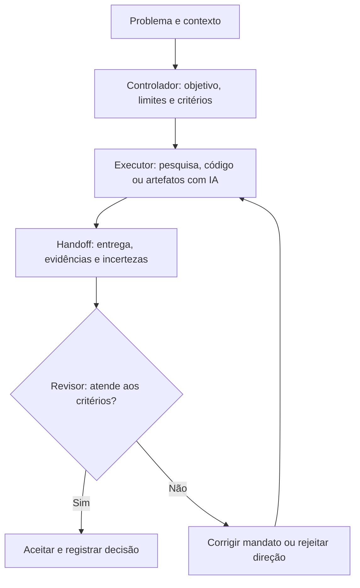

# Outro Eu — um fluxo de trabalho com IA que pode ser questionado

**Estudo de caso • Bruno Augusto • 2026**  
**Área:** IA generativa aplicada a processos, engenharia de prompts, coordenação humano–IA e decisões de produto  
**Estado:** método de trabalho experimental, aplicado em projetos e investigações; não é um SaaS nem uma infraestrutura de agentes implantada.

> **Problema:** modelos de IA conseguem produzir entregas convincentes que, ainda assim, não resolvem o problema solicitado. Como organizar execução, evidências e revisão sem transformar a IA em uma autoridade incontestável?

## Minha contribuição

Concebi e refinei um método de trabalho que separa **direção**, **execução** e **avaliação crítica**. Minha atuação envolve definir objetivos, estruturar mandatos, selecionar critérios de aceitação, conduzir revisões e decidir quando aceitar, corrigir ou abandonar resultados. A IA auxilia no processo; a responsabilidade pela decisão permanece humana.

## Como funciona

| Papel | Responsabilidade | Saída verificável |
| --- | --- | --- |
| **Controlador** | Identifica o problema, critérios de aceite, riscos e o que não deve ser feito. | Mandato com resultado esperado e limites. |
| **Executor** | Trabalha com IA e ferramentas, podendo criticar hipóteses e reportar bloqueios. | Artefato e registro das decisões/evidências. |
| **Revisão crítica** | Confronta resultado com o objetivo e procura contraevidências. | Aceite, correção ou rejeição fundamentada. |

Não é necessário que essas funções sejam três agentes em execução automática: em alguns trabalhos são papéis exercidos por conversas e revisões humanas distintas.

## Dois casos de aplicação

### 1. Detectar um protótipo que resolveu a tarefa errada

**Objetivo original:** construir um protótipo interativo de produto para demonstração, com telas, navegação e estados de uso.  
**Resultado observado:** uma entrega visualmente plausível, mas com natureza de *landing page*, sem representar os fluxos principais.  
**Avaliação:** não bastava a interface estar bem desenhada; o objetivo de produto não havia sido atendido. A entrega foi rejeitada.  
**Aprendizado operacional:** explicitar critérios de aceite associados a ações e fluxos observáveis, e não apenas a termos como "protótipo" ou "alta qualidade".

Esta é uma aplicação real do princípio de revisão. Não afirmo que a rejeição, sozinha, demonstrou ganho de produtividade.

### 2. Não proteger uma hipótese de negócio por ter investido nela

**Contexto:** investigação de oportunidades em ferramentas e experiências de RPG de mesa.  
**Risco:** transformar uma hipótese atraente em recomendação antes de confrontá-la com fornecedores e alternativas.  
**Aplicação:** rodadas sucessivas de investigação, contraevidência e reclassificação de propostas; quando soluções existentes já atendiam grande parte do problema, a tese de abrir um produto independente foi rebaixada.  
**Aprendizado:** um processo útil com IA precisa conseguir produzir um "não" fundamentado — e preservar o raciocínio que levou a ele.

Os documentos de trabalho completos não estão públicos; os exemplos acima são sínteses descritivas, sem publicação de materiais internos de projetos.

## Artefato reutilizável

[**Modelo de mandato e revisão (Markdown)**](./MODELO_MANDATO.md) — estrutura pronta para definir objetivo, fontes de verdade, limites, critérios de aceite, contraevidências e handoff. Foi preparada para permitir que outra pessoa experimente o fluxo em uma tarefa própria.

### Exemplo ilustrativo, não uma execução registrada

**Pedido vago:** "Faça um dashboard com IA para minha equipe."  
**Mandato mais testável:** "Crie um protótipo navegável que permita importar um CSV de exemplo, visualizar três indicadores e explicar os limites dos dados. Não invente fontes ou métricas; a revisão deve verificar os três fluxos e um estado de erro."  
**Revisão:** verificar navegação, origem dos dados, estado de erro e aderência ao usuário antes de aceitar.

O exemplo acima foi criado apenas para demonstrar a técnica, não é relato de um cliente ou uma funcionalidade implantada.

## O que este trabalho demonstra

- **Construção com IA:** transformar problemas abertos em tarefas verificáveis e revisáveis.
- **Engenharia de prompts e contexto:** mandatos, critérios de aceite, restrições e passagem entre etapas.
- **Pensamento de produto:** avaliar o resultado pelo problema resolvido, não pelo volume de funcionalidades ou texto gerado.
- **Colaboração e julgamento:** preservar autonomia de execução, contestar resultados e assumir responsabilidade pela decisão.

## Ferramentas e limitações

Experimentei o método com modelos de linguagem e ferramentas de desenvolvimento assistido por IA (incluindo ChatGPT/Codex), com documentação de decisões e revisões. **Não** atribuo ao estudo de caso treinamento de modelos, implantação de agentes autônomos, integrações n8n em produção ou redução de horas não medida.

**Evidências disponíveis:** este processo público, o modelo de mandato e relatos de aplicação sintetizados. **Não disponíveis publicamente:** registros integrais e repositórios privados, por motivos de contexto e confidencialidade.

## Próximo teste de qualidade

Aplicar o mesmo problema público a duas abordagens (prompt direto e mandato + revisão), guardar entradas e saídas, avaliar critérios idênticos e divulgar resultados inclusive se não houver melhora. Ainda não há uma comparação controlada que permita afirmar superioridade quantitativa.

---

**Autoria e transparência:** a estruturação do método, sua condução e sua avaliação crítica foram desenvolvidas por Bruno Augusto com apoio de sistemas de IA. O método é uma prática de trabalho, não um modelo de IA de autoria própria.
